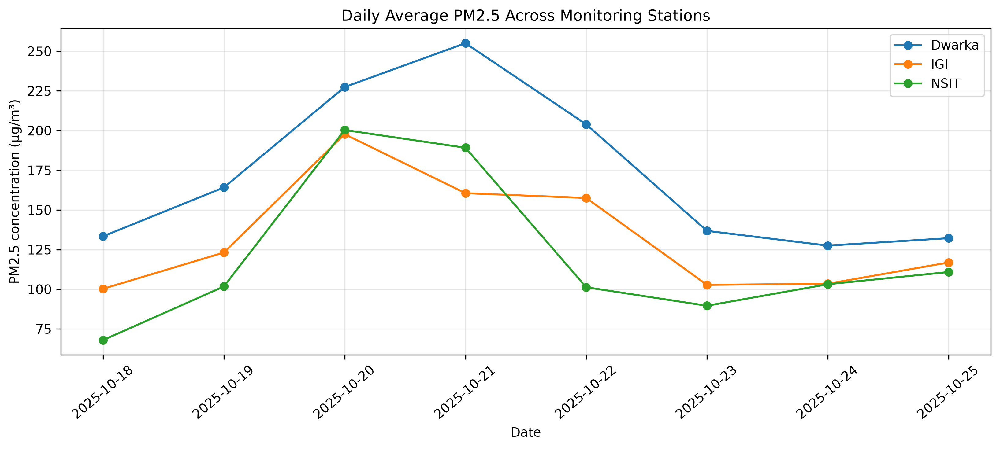
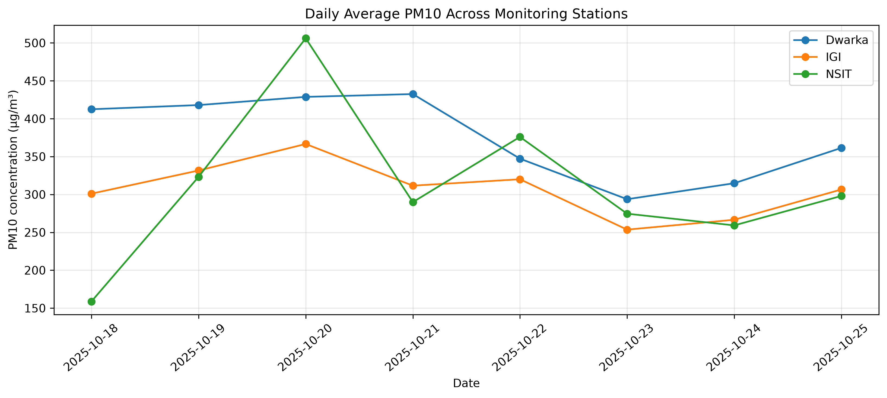
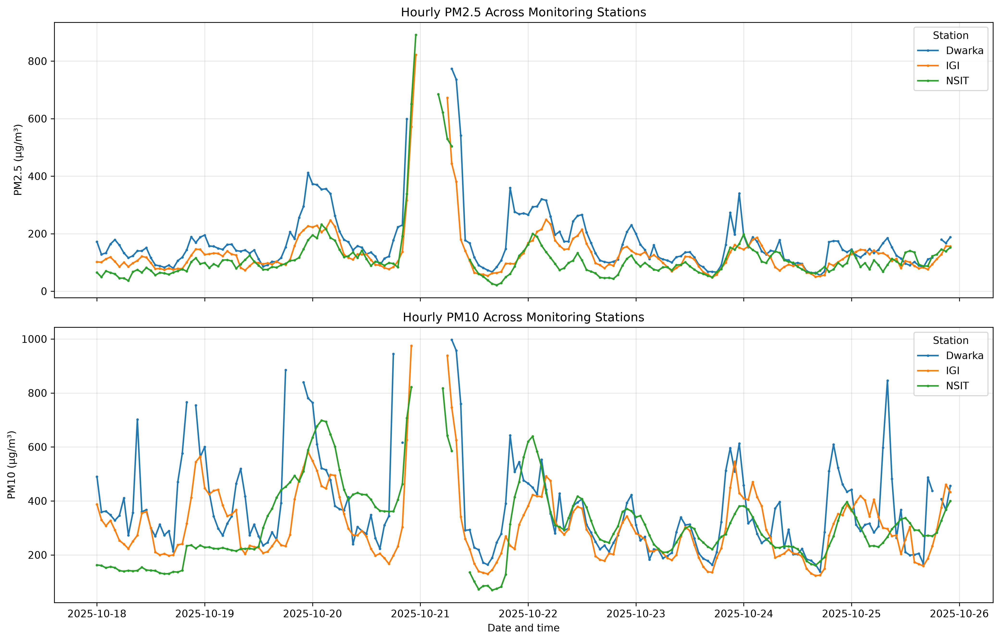
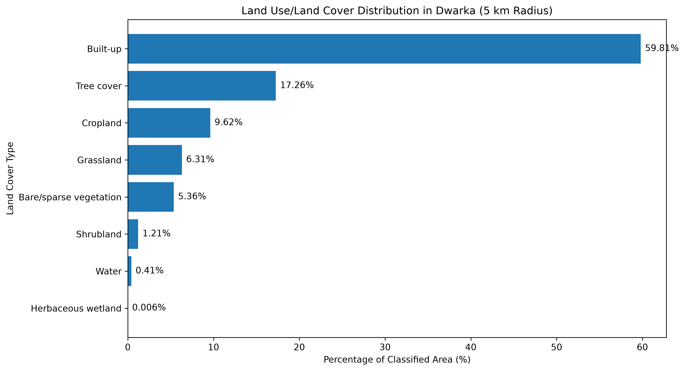
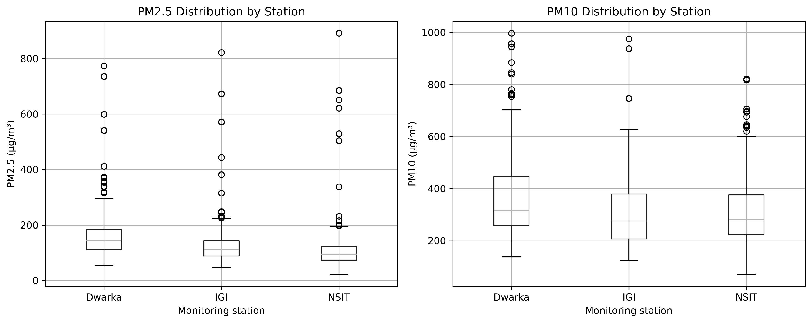
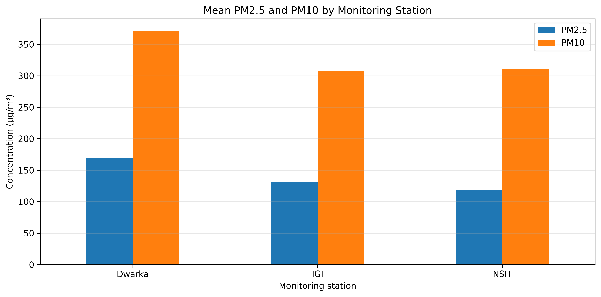
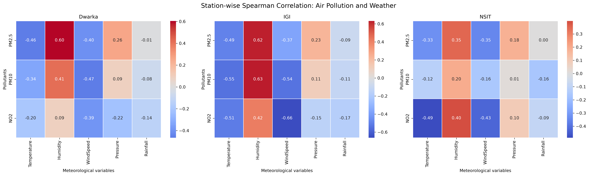
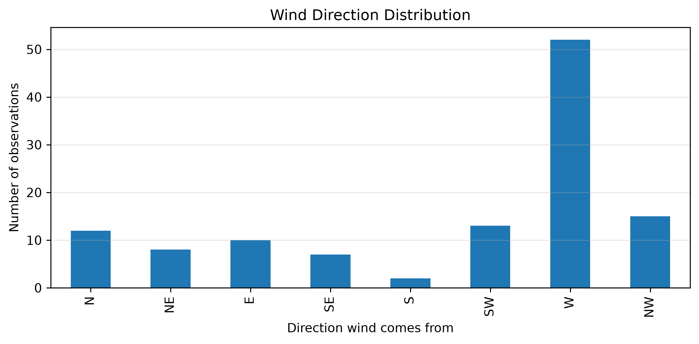

# GIS-Based Land Cover and Air Pollution Analysis of Dwarka, Delhi

## Project overview

This project combines GIS, satellite-derived land-cover information,
terrain data, CPCB air-quality observations and Meteostat meteorological
observations to examine the spatial context and short-term variation of
air pollution around Dwarka, Delhi.

The study focuses on three monitoring stations---Dwarka, IGI and
NSIT---and the period **18--25 October 2025**. The central GIS study
area is a **5 km radius around Dwarka Sector 8**.

The project has two connected parts:

1.  **GIS analysis:** mapping and quantifying land cover within the 5 km
    study area and preparing elevation, slope, hillshade, station and
    boundary layers.
2.  **Air-quality analysis:** cleaning and combining hourly pollution
    and weather data, comparing stations, examining temporal patterns,
    and exploring pollutant--weather and wind-direction associations.

The work is exploratory. It identifies patterns and associations in the
available data; it does not establish causal relationships or represent
long-term annual air quality.

------------------------------------------------------------------------

## 1. Objectives and questions

The project addresses the following questions:

-   What are the main land-cover classes within 5 km of Dwarka Sector 8,
    and what proportion of the mapped area does each class occupy?
-   How did PM2.5, PM10 and NO2 vary at Dwarka, IGI and NSIT from 18 to
    25 October 2025?
-   How do the stations compare in their mean pollutant concentrations
    and distributions?
-   Are temperature, relative humidity, wind speed, pressure, rainfall
    and wind direction associated with the observed pollutant
    concentrations?
-   What geographic and terrain context can be documented using the DEM,
    slope and hillshade products?
-   Which apparent changes in the plotted pollution series are supported
    by observations, and which are caused by missing data?

------------------------------------------------------------------------

## 2. Study area and monitoring stations

**Study-area centre:** Dwarka Sector 8, Delhi\
**Centre coordinates:** 28.5710° N, 77.0719° E\
**Study radius:** 5 km\
**Approximate circular area:** 78.54 km²\
**Projected GIS coordinate reference system:** WGS 84 / UTM zone 43N
(EPSG:32643)\
**Air-quality observation period:** 18--25 October 2025

  ------------------------------------------------------------------------
  Station                  Approximate distance from How it is used
                                       Dwarka centre 
  --------------------- ---------------------------- ---------------------
  Dwarka                                        0 km Central study-area
                                                     station

  IGI                                       4.601 km Station within the 5
                                                     km radius

  NSIT                                      5.717 km External comparison
                                                     station, outside the
                                                     5 km radius
  ------------------------------------------------------------------------

**Spatial interpretation caution:** the 5 km land-cover statistics
describe the Dwarka study area. They do not describe the surroundings of
all three monitoring stations. In particular, NSIT lies outside the 5 km
boundary and is included only as an external comparison station in the
air-quality analysis.

------------------------------------------------------------------------

## 3. Data sources and attribution

  --------------------------------------------------------------------------------------------------------------------------------------------------------------------------------------------------------------------------------------------------------------------------------
  Dataset                 Source                                                                                                                                                                                                                           Use in this project
  ----------------------- -------------------------------------------------------------------------------------------------------------------------------------------------------------------------------------------------------------------------------- -----------------------
  Air quality             [Central Pollution Control Board (CPCB) -- CAAQM advanced search](https://airquality.cpcb.gov.in/ccr/#/caaqm-dashboard-all/advance-search)                                                                                       Hourly
                                                                                                                                                                                                                                                           monitoring-station
                                                                                                                                                                                                                                                           observations for PM2.5,
                                                                                                                                                                                                                                                           PM10, NO2 and other
                                                                                                                                                                                                                                                           available pollutants

  Meteorology             [Meteostat -- Delhi, station 42181, 18--25 October 2025](https://meteostat.net/en/place/in/delhi?s=42181&t=2025-10-18/2025-10-25)                                                                                                Temperature, dew point,
                                                                                                                                                                                                                                                           relative humidity,
                                                                                                                                                                                                                                                           precipitation, wind
                                                                                                                                                                                                                                                           direction, wind speed
                                                                                                                                                                                                                                                           and pressure

  Elevation / terrain     [USGS EarthExplorer](https://earthexplorer.usgs.gov/)                                                                                                                                                                            Source DEM file
                                                                                                                                                                                                                                                           (`Dwarka.tif`) used to
                                                                                                                                                                                                                                                           derive terrain products

  Land cover              [ESA WorldCover viewer -- WorldCover 2021, 10                                                                                                                                                                                    Categorical land-cover
                          m](https://viewer.esa-worldcover.org/worldcover/?language=en&bbox=75.29923817819159,28.147579081407116,78.35315684998382,29.59437952408794&overlay=false&bgLayer=OSM&date=2026-10-31&layer=esa-worldcover-map-10m-2021-v2_map)   raster used for the 5
                                                                                                                                                                                                                                                           km area classification
                                                                                                                                                                                                                                                           and area calculation
  --------------------------------------------------------------------------------------------------------------------------------------------------------------------------------------------------------------------------------------------------------------------------------

### Correct terminology: land cover versus land use

The ESA WorldCover raster used here is a **land-cover** product. It
classifies the physical surface (for example, built-up, tree cover,
cropland, grassland and water). Therefore, the percentages calculated
from this raster are land-cover percentages. "LULC" is often used as a
broad project label, but the measured output in this analysis should be
described precisely as **land-cover composition**, not as a detailed
land-use inventory.

The meteorological data source used in the project is Meteostat (Delhi
station 42181). It should not be described as direct observations from a
separate IMD station unless an IMD-origin file or metadata confirms that
provenance.

------------------------------------------------------------------------

## 4. GIS methodology and outputs

### 4.1 Study boundary and station locations

A 5 km radius study boundary was created around the Dwarka Sector 8
centre. Station coordinates were loaded as point data and used to
calculate distances from the centre. The distances identify which
monitoring stations fall inside or outside the study boundary.

The 1 km station buffers were generated as a supporting spatial
exercise. They are not the boundary used for the main 5 km land-cover
calculation and were not used to produce the reported 5 km land-cover
percentages.

### 4.2 Land-cover processing

The ESA WorldCover 2021 10 m categorical raster was reprojected to
EPSG:32643. Nearest-neighbour resampling is appropriate for categorical
class codes because it preserves the original class labels rather than
creating interpolated class values.

The raster was clipped to the 5 km study boundary, and valid pixels were
counted by land-cover class. A 10 m × 10 m pixel represents 100 m².
Pixel counts were converted to area and percentages were calculated
using the valid classified area. NoData pixels were excluded from the
class-percentage denominator.

#### Reported land-cover composition

  Land-cover class             Share of valid classified area
  -------------------------- --------------------------------
  Built-up                                             59.81%
  Tree cover                                           17.26%
  Cropland                                              9.62%
  Grassland                                             6.31%
  Bare / sparse vegetation                              5.36%
  Shrubland                                             1.21%
  Water                                                 0.41%
  Herbaceous wetland                                   0.006%

Reported raster accounting: - Valid classified pixels: **785,247** -
Pixel area: **100 m²** - Valid classified area: **78.5247 km²** - Total
raster pixels: **998,001** - NoData pixels: **212,754**

The valid classified area is close to the approximate area of a 5
km-radius circle. Small differences can arise from raster-cell geometry,
clipping and NoData coverage.

**Interpretation:** built-up land is the dominant mapped class (59.81%).
Tree cover is the second-largest class (17.26%). Cropland and grassland
together contribute a further 15.93%. Water and herbaceous wetland
occupy very small mapped shares. This describes the physical surface
composition of the study area; it does not by itself measure emissions,
traffic, industrial activity or the causal contribution of each class to
pollution.

### 4.3 Terrain processing

The source elevation raster (`Dwarka.tif`, downloaded from USGS
EarthExplorer) was reprojected to EPSG:32643 at 30 m resolution. A
study-area DEM was prepared, and slope and hillshade rasters were
derived.

  -----------------------------------------------------------------------
  Terrain output                      Purpose
  ----------------------------------- -----------------------------------
  `DEM_30m.tif`                       Reprojected 30 m elevation raster

  `DEM_5km.tif`                       Elevation raster clipped to the 5
                                      km study area

  `Slope.tif`                         Slope in degrees; Z factor 1

  `Hillshade.tif`                     Shaded-relief visualisation;
                                      azimuth 315°, vertical angle 45°
  -----------------------------------------------------------------------

Reported elevation statistics: - Minimum: **181 m** - Maximum: **273
m** - Range: **92 m** - Mean: **219.98 m** - Standard deviation: **7.09
m**

The terrain layers document the topographic setting and support GIS
visualisation. No atmospheric dispersion, flow, or terrain-driven
pollutant transport model was performed; therefore, the DEM, slope and
hillshade cannot be used to claim that terrain caused a particular
measured pollution pattern.

### 4.4 Supporting station-buffer GIS work

The 1 km station buffers, station-buffer land-cover output and
station-distance layer are retained as supporting GIS products. They
document additional spatial processing but are not the basis of the main
5 km land-cover statistics.

The inspected `LULC_Final.gpkg` / associated `LULC_Stats.csv` output
contains three station records and fields including `HubDist` and
land-cover class fields (`LC_10` to `LC_80`). It represents
station-buffer analysis, not a single polygon or raster summary of the
complete 5 km Dwarka study area.

The file `WC_Stations_Clipped.tif` is a separate station-area clipped
raster. Do not label it as the 5 km study-area raster unless its extent
is verified in QGIS.

------------------------------------------------------------------------

## 5. Air-quality data preparation

CPCB hourly exports were collected for Dwarka, IGI and NSIT. The
original exports contain a metadata preamble before the observation
table. The preprocessing notebook skips the first nine rows, assigns
column names, parses timestamps, converts pollutant fields to numeric
values, labels each station and sorts observations by time.

The three cleaned station datasets were combined into one station-wise
dataset.

### Primary pollutants

The main analysis focuses on: - **PM2.5:** particulate matter with
aerodynamic diameter up to 2.5 µm. - **PM10:** particulate matter with
aerodynamic diameter up to 10 µm. - **NO2:** nitrogen dioxide.

Other CPCB fields include NOx, SO2, CO and Ozone. In the combined
cleaned data, NOx and Ozone are entirely missing; SO2 and CO also have
substantial missingness. They are not used as primary variables in the
main comparisons and conclusions.

### Dataset size and missing observations

The combined air-quality dataset contains **573 rows**, with **191
observations per station** before pollutant-specific missing values are
excluded.

  Variable     Available observations   Missing observations
  ---------- ------------------------ ----------------------
  PM2.5                           550                     23
  PM10                            541                     32
  NO2                             573                      0

Missing values were retained as missing. They were not changed to zero
and were not interpolated for the reported statistics. Each daily mean
is calculated from the available readings for that station and day; the
valid observation count is important when comparing daily means.

------------------------------------------------------------------------

## 6. Meteorological data preparation and alignment

The Meteostat file covers 18--25 October 2025. The weather variables
used in the combined analysis are:

-   Temperature (`temp`)
-   Relative humidity (`rhum`)
-   Wind speed (`wspd`)
-   Atmospheric pressure (`pres`)
-   Precipitation (`prcp`)
-   Wind direction (`wdir`)

The CPCB observations represent hourly intervals beginning at
`from_time`. Their midpoint was calculated as `from_time + 30 minutes`.
This midpoint was matched to the half-hour weather timestamp. The
weather fields were renamed to `Temperature`, `Humidity`, `WindSpeed`,
`Pressure`, `Rainfall` and `WindDirectionDegrees`.

The weather time series is shared across the three station records at a
matching timestamp. It is not an independent weather sensor measurement
at each CPCB station. This is important when interpreting station-wise
correlations.

There were **73 calm-wind weather records** (`wspd == 0`). Calm records
were excluded from the wind-direction frequency analysis because a
direction is not meaningful when wind speed is zero.

------------------------------------------------------------------------

## 7. Air-quality results

### 7.1 Mean pollutant concentration by station

The following means are calculated from the cleaned hourly observations
over the full eight-day period.

  Station     Mean PM2.5 (µg/m³)   Mean PM10 (µg/m³)   Mean NO2 (µg/m³)
  --------- -------------------- ------------------- ------------------
  Dwarka                  169.19              371.92              74.51
  IGI                     131.97              306.78             126.95
  NSIT                    117.95              310.66              72.55

**Station comparison:** - Dwarka has the highest mean PM2.5 and PM10
among the three stations during this period. - IGI has the highest mean
NO2. - NSIT has the lowest mean PM2.5 and NO2, while its mean PM10 is
slightly higher than IGI's.

These are comparisons for the selected stations and dates only. They
should not be generalised to annual station rankings or all of Delhi.

### 7.2 Daily PM2.5 and PM10 patterns

Daily means calculated directly from the hourly CPCB observations are:

  -----------------------------------------------------------------------
  Station                 PM2.5 peak daily mean   PM10 peak daily mean
  ----------------------- ----------------------- -----------------------
  Dwarka                  255.06 µg/m³ on 21 Oct  432.53 µg/m³ on 21 Oct
                          (17 valid readings)     (17 valid readings)

  IGI                     197.73 µg/m³ on 20 Oct  366.64 µg/m³ on 20 Oct
                          (24 valid readings)     (23 valid readings)

  NSIT                    200.34 µg/m³ on 20 Oct  506.13 µg/m³ on 20 Oct
                          (24 valid readings)     (23 valid readings)
  -----------------------------------------------------------------------

The daily pattern is not identical at all stations: - At Dwarka, PM2.5
and PM10 daily means increase through 21 October, when both reach their
highest daily mean in the study period. - At IGI, both particulate daily
means peak on 20 October and are lower on 21--23 October, with some
increase again by 25 October. - At NSIT, PM2.5 peaks on 20 October and
decreases on 21--23 October before a modest recovery. PM10 peaks on 20
October, decreases on 21 October, rises again on 22 October, and then
decreases on 23--24 October.

Diwali fell on **20 October 2025**. The timing of elevated particulate
readings around 20--21 October is relevant context. However, the dataset
is too short and lacks source-apportionment or a control design to
establish that fireworks caused the observed peaks. The results also do
not show a single, simultaneous post-Diwali decline across all stations
and both particulate pollutants.

### 7.3 Hourly trends, gaps and the apparent sudden drops

Hourly plots reveal short-term variation and high readings around 20--21
October, along with later fluctuations. They also contain missing
observations.

**Important interpretation rule:** a line break or missing segment in an
hourly time-series graph means that no valid observation is available at
that timestamp. It is not a measured fall in concentration. A plotting
routine that connects observations across a long gap can also make the
line look like a sudden fall or rise, even though the intermediate
values were not recorded.

The combined data contain 23 missing PM2.5 values and 32 missing PM10
values. Consequently: - Do not interpret a missing-data gap as clean air
or a zero concentration. - Do not claim that pollution suddenly dropped
at a time when the sensor record is absent. - Daily averages are
calculated from the readings that exist; the number of valid readings
should be reported alongside each daily mean. - 21 October has fewer
observations than a complete 24-hour day at the stations: Dwarka has 17
PM2.5 and 17 PM10 readings; IGI has 18 and 18; NSIT has 17 PM2.5 and 16
PM10 readings. This reduced coverage makes those daily means less
complete than a full-day mean.

The hourly graph that displayed empty axes was a plotting/data-selection
problem, not evidence of zero pollution. The corrected hourly plot uses
the combined dataset with the `station` labels and valid `from_time`
timestamps.

### 7.4 Pollutant distributions and high observations

The station-wise boxplots show broad distributions and high observations
above the upper whiskers. The IQR screening flagged 61 observations.
These were checked against the corresponding cleaned station source
files and matched the source observations. They were retained rather
than automatically deleted.

A statistical outlier is an observation unusually far from the central
distribution; it is not automatically an erroneous sensor value. The
high readings may represent genuine short-lived pollution episodes, but
this project does not independently validate each event against
instrument logs or source records.

### 7.5 Relationship between PM2.5 and PM10

  Station     Pearson correlation (r)   Spearman correlation (ρ)
  --------- ------------------------- --------------------------
  Dwarka                        0.706                      0.767
  IGI                           0.888                      0.898
  NSIT                          0.727                      0.714

Both Pearson and Spearman results show positive PM2.5--PM10 associations
at all three stations. The association is strongest at IGI in this
sample. This indicates that higher fine-particle readings tend to
coincide with higher coarse-inclusive particulate readings. It does not
identify the source of the particles.

------------------------------------------------------------------------

## 8. Meteorology and pollution

Station-wise Spearman rank correlations were calculated between PM2.5,
PM10 and NO2 and five weather variables. Selected particulate results
are shown below.

  Station   Pollutant     Temperature   Humidity   Wind speed
  --------- ----------- ------------- ---------- ------------
  Dwarka    PM2.5               -0.46      +0.60        -0.40
  Dwarka    PM10                -0.34      +0.41        -0.47
  IGI       PM2.5               -0.49      +0.62        -0.37
  IGI       PM10                -0.55      +0.63        -0.54
  NSIT      PM2.5               -0.33      +0.35        -0.35
  NSIT      PM10                -0.12      +0.20        -0.16

### Interpretation

-   **Relative humidity:** positive associations with PM2.5 and PM10
    occur at all three stations. The associations are strongest at IGI
    in this sample. Humidity can coincide with changes in particle
    behaviour and atmospheric conditions, but the correlations alone do
    not demonstrate a mechanism or causal effect.
-   **Temperature:** negative associations are observed for the
    particulate pollutants at all three stations, although the strength
    varies. Temperature may co-vary with time of day and other
    meteorological conditions, so the correlation should not be
    interpreted as an isolated temperature effect.
-   **Wind speed:** negative associations are observed for particulate
    concentrations, particularly at Dwarka and IGI. Stronger winds can
    be associated with greater dispersion, but this analysis does not
    directly model dispersion or prove that wind caused lower
    concentrations.
-   **Pressure and rainfall:** their correlations are generally weaker
    in this short dataset and do not support a strong standalone
    conclusion.

The correlations are exploratory. Hourly observations can be serially
autocorrelated, and the same weather time series is joined to each
station. The station-wise sample sizes therefore do not represent three
independent weather datasets. No causal inference should be made from
these coefficients.

------------------------------------------------------------------------

## 9. Wind-direction analysis

Wind direction is reported as the direction **from which** the wind
comes. Calm-wind observations were excluded. The analysis contains 119
non-calm weather timestamps.

  Wind direction     Number of observations   Approximate share
  ---------------- ------------------------ -------------------
  W                                      52               43.7%
  NW                                     15               12.6%
  SW                                     13               10.9%
  N                                      12               10.1%
  E                                      10                8.4%
  NE                                      8                6.7%
  SE                                      7                5.9%
  S                                       2                1.7%

Westerly winds are the most frequent sector during the observed period.
Pollution means were also grouped by wind sector and station. Some
sectors have very small sample counts---for example, only two southerly
observations---so their averages are unstable and should be treated as
descriptive.

The higher PM2.5 means in the easterly sector in this sample do not
establish that an eastern source caused the pollution. Wind-direction
analysis here is not a source-apportionment study and does not identify
a particular emitting location.

------------------------------------------------------------------------

## 10. Figures, maps and tables

The project produces the following visual and tabular outputs.

## Figures

### Daily PM2.5 Trends


### Daily PM10 Trends


### Hourly Pollution Trends


### Land Cover Distribution


### Pollutant Distributions


### Station Comparison


### Weather Correlation Heatmap


### Wind Direction Distribution


The GIS deliverables include the 5 km study boundary, station locations,
WorldCover raster and land-cover map, DEM, slope, hillshade,
station-distance output and optional 1 km station-buffer layers.

------------------------------------------------------------------------

## 11. Overall conclusion

This project combines land-cover mapping, terrain preparation,
station-based pollution observations and meteorological analysis to
describe the environmental context and short-term air-quality variation
around Dwarka during Diwali 18-25 October 2025.

### What the GIS results tell us

The 5 km Dwarka study area is predominantly built-up: built-up land
accounts for **59.81%** of the valid classified area. Tree cover
accounts for **17.26%**, followed by cropland (**9.62%**) and grassland
(**6.31%**). The remaining classes bare/sparse vegetation, shrubland,
water and herbaceous wetland occupy smaller shares.

This land-cover composition indicates a highly urbanised study area with
a smaller but meaningful share of vegetated and agricultural cover.
Built-up surfaces and urban activity can be relevant context when
considering traffic, construction, resuspended dust and other potential
urban pollution sources. However, this project did not measure emissions
from individual land-cover classes or quantify a causal effect of
built-up area on pollutant concentrations. The map describes the
setting; it does not by itself prove the source of pollution.

The DEM, slope and hillshade provide additional information about
elevation and terrain. The elevation range is 181-273 m, with a mean of
about 219.98 m. These products help document the physical geography of
the area, but no dispersion modelling was conducted. Therefore, the
project cannot conclude that a particular slope or elevation pattern
increased or reduced the measured pollution.

### What the monitoring data tell us

Across the three stations, Dwarka recorded the highest mean PM2.5
(**169.19 µg/m³**) and PM10 (**371.92 µg/m³**) during the eight day
period. IGI recorded the highest mean NO2 (**126.95 µg/m³**). PM2.5 and
PM10 were positively correlated at all three stations, indicating that
fine and broader particulate concentrations tended to rise and fall
together.

The daily plots show high particulate levels around 20-21 October, but
the timing and magnitude differ by station. Dwarka's daily PM2.5 and
PM10 means peak on 21 October, whereas IGI and NSIT reach their daily
PM2.5 peaks on 20 October. NSIT also records the highest daily PM10 mean
on 20 October. Diwali occurred on 20 October 2025, making it relevant
temporal context, but the eight day observational record cannot
establish that fireworks caused the peaks. The pattern is not a uniform
post event decline across all stations.

### What the weather analysis suggests

Humidity is positively associated with PM2.5 and PM10 at all three
stations. Temperature and wind speed generally show negative
associations with particulate concentrations, although the strengths
vary. These patterns are consistent with weather conditions being
related to the observed variation, but they do not prove that any one
variable caused the changes. The weather data are shared across
stations, and hourly measurements are not necessarily independent.

Westerly winds account for approximately 43.7% of the 119 non-calm
observations. Wind-sector pollution summaries are exploratory because
several directions have few observations. The results do not identify a
pollution source direction.

### How to interpret the apparent sudden drops

The hourly dataset has missing pollutant values: **23 PM2.5** and **32
PM10** observations. Where the hourly graph breaks or skips timestamps,
the correct explanation is missing monitoring data, not a sudden fall in
pollution. Missing values were not replaced with zero. Daily means use
available readings and must be interpreted with their valid sample
counts. In particular, 21 October has reduced hourly coverage at all
three stations, so its daily means are based on fewer than 24 readings.

Where valid observations resume after a high reading and show lower
concentrations, that decrease is present in the recorded observations.
It should be distinguished from a blank interval or line discontinuity
caused by missing data. The empty hourly plot encountered during
development was a plotting/data-selection issue; it was not evidence of
zero concentration.

### Overall finding

The combined evidence describes an urbanised 5 km Dwarka landscape and
substantial particulate pollution during the selected late-October
period. Pollution levels differ between monitoring stations and vary
over time. The meteorological correlations indicate that humidity,
temperature and wind speed co-varied with particulate concentrations,
while wind direction was predominantly westerly. The GIS layers provide
spatial and terrain context for interpreting these observations.

The strongest defensible conclusion is that **land-cover composition,
station location, temporal variation and meteorological conditions
together provide useful context for understanding the observed
air-quality pattern, but this project does not establish causal source
contributions**. The results are limited to three stations and eight
days, contain missing hourly observations, and use one shared weather
series. Longer monitoring periods, more spatially distributed weather
data, source inventories and dispersion or source-apportionment
modelling would be needed for stronger causal conclusions.

------------------------------------------------------------------------

## 12. Project folder organisation
├── README.md
└── QGIS/
    ├── GIS_Analysis.qgz
    └── Data/
        ├── raw/
        │   ├── CPCB station source exports
        │   ├── Meteostat source data
        │   ├── Dwarka.tif
        │   └── ESA WorldCover 2021 source raster
        │
        └── processed/
            ├── Data_Preprocessing.ipynb
            ├── Air_Quality_Analysis.ipynb
            ├── cleaned station CSV files
            ├── combined air-quality and weather CSV files
            └── derived DEM, slope and hillshade rasters
        
    ├── GIS/
    │   ├── Stations.gpkg
    │   ├── Stations.csv
    │   ├── Dwarka_5km_Boundary.gpkg
    │   ├── WorldCover_UTM43N.tif
    │   ├── DEM_30m.tif
    │   ├── DEM_5km.tif
    │   ├── Slope.tif
    │   └── Hillshade.tif
    │
    ├── GIS_optional/
    │   ├── LULC_Final.gpkg
    │   ├── Station_Buffers_1km.gpkg
    │   ├── Station_Distances.gpkg
    │   ├── LULC_Stats.csv
    │   └── WC_Stations_Clipped.tif
    │
    └── Results/
        ├── figures/
        ├── maps/
        └── tables/
```

## 13. Limitations

1.  **Short observation period:** eight days are insufficient to
    describe seasonal or annual air quality.
2.  **Station coverage:** only three stations are analysed; NSIT is
    outside the 5 km GIS boundary.
3.  **Missing data:** 23 PM2.5 and 32 PM10 values are missing. Missing
    readings are not zero and can affect daily means and apparent hourly
    trends.
4.  **Unequal daily coverage:** some days have fewer than 24 valid
    readings, particularly 21 October.
5.  **Weather matching:** one Meteostat weather time series is matched
    to all three CPCB stations; it is not station-specific meteorology.
6.  **Temporal dependence:** hourly observations may be autocorrelated,
    so ordinary correlation significance tests could overstate
    independent evidence.
7.  **Correlation is not causation:** weather associations do not prove
    meteorological causes, and timing around Diwali does not prove a
    fireworks effect.
8.  **Land cover is not emissions:** WorldCover describes surface
    classes, not pollutant emissions or detailed land-use activity.
9.  **No source apportionment or dispersion modelling:** the analysis
    cannot identify the contribution of traffic, industry, dust,
    fireworks or a specific wind-origin location.
10. **GIS extent verification:** the station-area clipped raster and
    station-buffer outputs must not be mistaken for the complete 5 km
    land-cover result.

------------------------------------------------------------------------